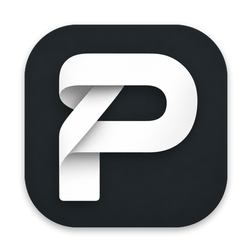
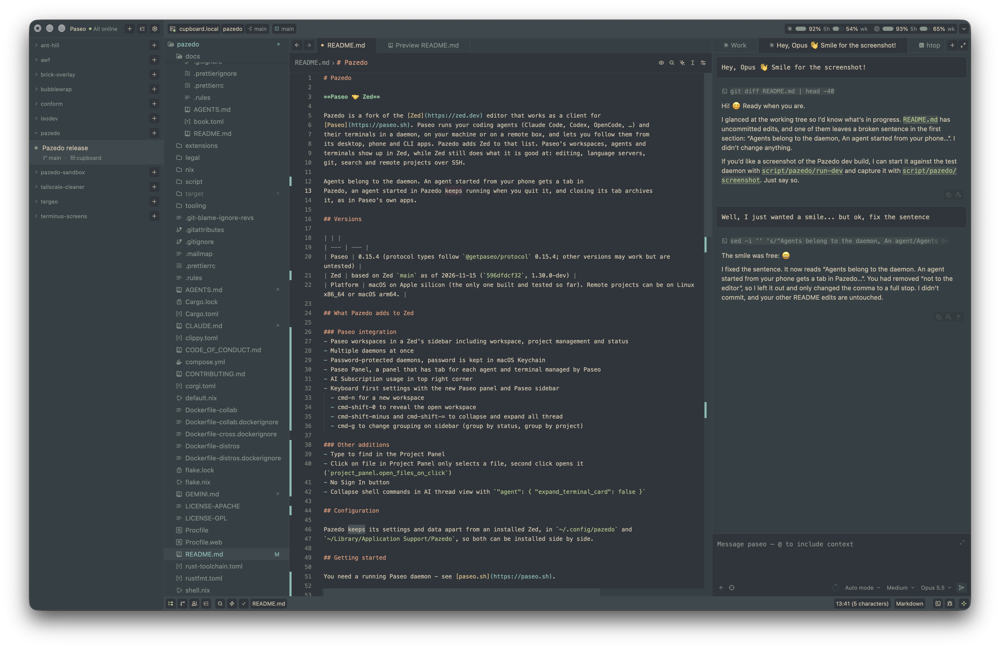

# Pazedo

**Paseo 🤝 Zed**

Pazedo is a fork of the [Zed](https://zed.dev) editor that works as a client for [Paseo](https://paseo.sh).

Paseo runs your coding agents (Claude Code, Codex, OpenCode, …) and their terminals in a daemon, on your machine or on a remote box, and lets you follow them from its desktop, phone and CLI apps.

Pazedo adds Zed to that list. Paseo's workspaces, agents and terminals show up in Zed, while Zed still does what it is good at: editing, language servers, git, search and remote projects over SSH.

Agents belong to the daemon. An agent started from your phone gets a tab in Pazedo, and an agent started in Pazedo keeps running when you quit Pazedo.



## Why

Paseo is great at:
- Aggregating all my dev machines and all coding harnesses.
- Exposing them through Tailscale to my phone.
- Vibecoding, when I don't need to read the code.
- A well-thought-out model of workspaces that works for me.
- A CLI to manage Paseo, so an agent can orchestrate things.
- UI plugins.
- Accessing all of it as a website from anywhere.

Paseo is lacking in:
- Speed. The app is written in Electron (for good reason). It's OK, but not amazing.
- Code editing and navigation. No language servers, limited search, etc.

Zed is great at:
- Speed! Zed is blazing fast and light on memory. It's written in Rust. It's the fastest editor I've ever used.
- Code editing and navigation. It runs language servers on remote machines too.
- Customizability. It's really keyboard-first: you can set a shortcut for everything.

Zed is lacking in:
- It can't expose threads to my phone, except natively through each harness's own app.
- Its sidebar model is thread-oriented: multiple agents have multiple threads.
- No CLI or other tools to manage threads programmatically.

Pazedo tries to capture the benefits of both products.
Since Pazedo is just a Paseo client, you can still use the Paseo app simultaneously.

## Versions

| | |
| --- | --- |
| Paseo | 0.16.2 (protocol types follow `@getpaseo/protocol` 0.16.2; other versions may work but are untested) |
| Zed | based on Zed `main` as of 2026-11-15 (`596dfdcf32`, 1.30.0-dev) |
| Platform | macOS on Apple silicon (the only one built and tested so far). Remote projects can be on Linux x86_64 or macOS arm64. |

## What Pazedo adds to Zed

### Paseo integration
- Paseo workspaces in Zed's sidebar, including workspace and project management and status
- Multiple daemons at once
- Password-protected daemons; the password is kept in the macOS Keychain
- Paseo Panel, a panel with a tab for each agent and terminal managed by Paseo
- AI subscription usage in the top right corner
- Keyboard-first settings
  - Paseo Sidebar
    - cmd-n for a new workspace
    - cmd-shift-0 to reveal the open workspace
    - cmd-shift-minus and cmd-shift-= to collapse and expand all workspaces
    - cmd-g to change the sidebar's grouping (by status or by project)
  - Paseo Panel
    - cmd-n for a new terminal or agent

### Other additions
- Type-to-find in the Project Panel
- Clicking a file in the Project Panel only selects it, and a second click opens it (`project_panel.open_files_on_click`)
- No Sign In button
- Collapse shell commands in AI thread view with `"agent": { "expand_terminal_card": false }`

## Configuration

Pazedo keeps its settings and data apart from an installed Zed, in `~/.config/pazedo` and
`~/Library/Application Support/Pazedo`, so both can be installed side by side.

## Getting started

You need a running Paseo daemon; see [paseo.sh](https://paseo.sh).

Building Pazedo from source is recommended (see [Development](#development)). Prebuilt apps for
macOS on Apple silicon are on the [releases page](https://github.com/jakubdyszkiewicz/pazedo/releases).
They are not notarized, so after moving Pazedo.app to Applications, lift macOS's quarantine:

```sh
xattr -dr com.apple.quarantine /Applications/Pazedo.app
```

## Development

Building Pazedo needs Rust and Xcode, as for [building Zed on macOS](./docs/src/development/macos.md).

```sh
script/pazedo/bundle --install   # release build into ~/Applications/Pazedo.app (about 30 minutes)
```

Then point Pazedo at your daemon in `~/.config/pazedo/settings.json`:

```json
"paseo": { "endpoint": "127.0.0.1:6767" }
```

For a daemon on another machine, add the SSH host where its folders are. You can also list
several daemons:

```json
"paseo": {
  "daemons": [
    { "endpoint": "127.0.0.1:6767" },
    { "name": "dev box", "endpoint": "dev-box:6767", "ssh": "user@dev-box" }
  ]
}
```

Daemons can also be added and edited from the gear button in the sidebar header.

### Updating

Pazedo doesn't update itself: it builds Zed's dev channel, which has no update server, and the
app never checks for new versions. To update, download a newer release, or pull this repository
and build again:

```sh
git pull
script/pazedo/bundle --install
```

## Documentation

- [docs/pazedo/development.md](./docs/pazedo/development.md): building, settings and every
  feature in detail, with how each one was verified.
- [docs/pazedo/README.md](./docs/pazedo/README.md): how the fork is organized, syncing with
  upstream Zed, and every place where Zed's own code was changed.
- [docs/pazedo/paseo-protocol.md](./docs/pazedo/paseo-protocol.md): the parts of Paseo's daemon
  protocol that Pazedo uses.
- [docs/pazedo/agent-sessions.md](./docs/pazedo/agent-sessions.md) and
  [docs/pazedo/terminals.md](./docs/pazedo/terminals.md): how agents and terminals are shown.
- [docs/pazedo/todo.md](./docs/pazedo/todo.md): what is still missing.

## How the fork is built

Most of Pazedo is in its own crates:
- `paseo_client` (the daemon protocol, without UI)
- `paseo_ui` (the sidebar, panel, agent and terminal tabs, usage indicator)

Zed's own code is changed in only a few places, each listed in [docs/pazedo/README.md](./docs/pazedo/README.md),
so that upstream Zed can be merged in often.

Pazedo was mostly vibecoded, so use your own judgement about whether to try it.

## License

Like Zed, Pazedo is licensed under GPL-3.0-or-later, with Apache-2.0 components where marked
(see [LICENSE-GPL](./LICENSE-GPL) and [LICENSE-APACHE](./LICENSE-APACHE)).

Pazedo is an independent project. It is not affiliated with or endorsed by Zed Industries or
the Paseo project.
